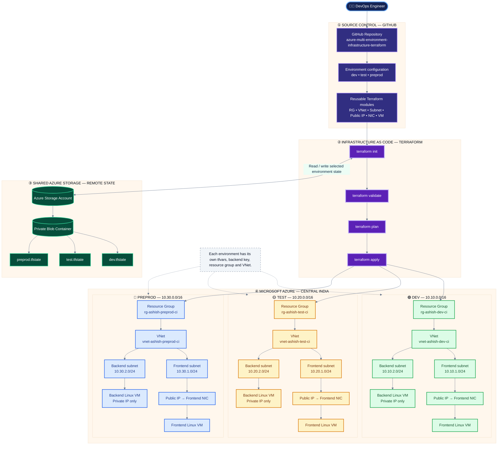

<div align="center">

# ☁️ Azure Multi-Environment Infrastructure Automation
### Enterprise-Style Azure Infrastructure Provisioning with Terraform

**Dev • Test • Preprod | Reusable Modules | Remote State | Infrastructure as Code**

[](https://www.terraform.io/)
[](https://azure.microsoft.com/)
[](https://developer.hashicorp.com/terraform/language)
[](https://github.com/)

*Provision consistent, repeatable and environment-isolated Azure infrastructure using reusable Terraform modules.*

</div>

---

## 📑 Table of Contents

- [Project Overview](#-project-overview)
- [Business Objective](#-business-objective)
- [Architecture at a Glance](#-architecture-at-a-glance)
- [Detailed Architecture](#-detailed-architecture)
- [Environment Design](#-environment-design)
- [Resource Naming Convention](#-resource-naming-convention)
- [Repository Structure](#-repository-structure)
- [Terraform Modules](#-terraform-modules)
- [Network Architecture](#-network-architecture)
- [Remote State Management](#-remote-state-management)
- [Prerequisites](#-prerequisites)
- [Initial Setup](#-initial-setup)
- [Deployment Guide](#-deployment-guide)
- [Validation and Verification](#-validation-and-verification)
- [Change Management Workflow](#-change-management-workflow)
- [Security Considerations](#-security-considerations)
- [Cost Management](#-cost-management)
- [Destroy / Cleanup](#-destroy--cleanup)
- [Troubleshooting](#-troubleshooting)
- [Learning Outcomes](#-learning-outcomes)
- [Roadmap](#-roadmap)
- [Author](#-author)

---

## 🚀 Project Overview

This repository demonstrates how to provision Azure infrastructure using **Terraform**, following a reusable-module and multi-environment approach.

The same infrastructure design is used across three isolated environments:

| Environment | Purpose | Network range |
|---|---|---|
| 🟢 **Development (Dev)** | Build features and perform developer testing | `10.10.0.0/16` |
| 🟡 **Testing (Test)** | Validate changes before pre-production | `10.20.0.0/16` |
| 🔵 **Pre-Production (Preprod)** | Perform final production-like validation | `10.30.0.0/16` |

Each environment is provisioned independently. Environment-specific values are maintained in separate `terraform.tfvars` and backend configuration files, while reusable Terraform modules keep the infrastructure code consistent.

> **Project scope:** This repository provisions a two-tier compute/network foundation: a frontend Linux VM and a backend Linux VM in separate subnets. A database tier, application deployment, load balancer, and production-grade security controls can be added as future enhancements.

## 🎯 Business Objective

In a manual cloud setup, teams may create resources differently in each environment. This can lead to configuration drift, inconsistent naming, accidental resource overlap, and difficult maintenance.

This project addresses those challenges by:

- Defining Azure infrastructure as code.
- Reusing Terraform modules instead of duplicating resource logic.
- Separating Dev, Test, and Preprod configuration.
- Using non-overlapping virtual network address ranges.
- Keeping frontend and backend workloads in separate subnets.
- Maintaining an independent Terraform state file for each environment.
- Making infrastructure changes reviewable through Git.
- Supporting repeatable deployment and controlled cleanup.

## 🧭 Architecture at a Glance

The following diagram shows the complete intended flow from the engineer's GitHub repository to Terraform and the three Azure environments.



## 🏛️ Detailed Architecture

### 1. Source control layer

GitHub stores the Terraform source code and environment-specific configuration.

- The `modules/` directory contains reusable resource definitions.
- The `environments/` directory contains the configuration for Dev, Test, and Preprod.
- Changes can be reviewed and versioned using Git commits and pull requests.

### 2. Terraform execution layer

Terraform reads the selected environment configuration and provisions the required Azure resources.

| Command | Purpose |
|---|---|
| `terraform init` | Initializes providers, modules, and backend |
| `terraform fmt -recursive` | Formats Terraform files |
| `terraform validate` | Checks configuration syntax and consistency |
| `terraform plan` | Previews proposed infrastructure changes |
| `terraform apply` | Applies the reviewed changes |
| `terraform output` | Displays configured output values |

### 3. Remote state layer

Terraform state records the relationship between Terraform configuration and real Azure resources.

This project uses separate state keys:

- `dev.tfstate`
- `test.tfstate`
- `preprod.tfstate`

The state backend storage account and container are shared, but each environment uses a different blob key. This prevents the three environments from sharing one state file.

### 4. Azure infrastructure layer

Each environment has its own:

- Resource Group
- Virtual Network
- Frontend subnet
- Backend subnet
- Frontend Public IP
- Frontend Network Interface
- Backend Network Interface
- Frontend Linux Virtual Machine
- Backend Linux Virtual Machine

---

## 🌍 Environment Design

### 🟢 Development

Development is the first environment where infrastructure and application changes are introduced.

| Resource | Name |
|---|---|
| Resource Group | `rg-ashish-dev-ci` |
| Virtual Network | `vnet-ashish-dev-ci` |
| Address space | `10.10.0.0/16` |
| Frontend subnet | `snet-frontend-dev-ci` — `10.10.1.0/24` |
| Backend subnet | `snet-backend-dev-ci` — `10.10.2.0/24` |
| Public IP | `pip-frontend-dev-ci` |
| Frontend NIC | `nic-frontend-dev-ci` |
| Backend NIC | `nic-backend-dev-ci` |
| Frontend VM | `vm-frontend-dev-ci` |
| Backend VM | `vm-backend-dev-ci` |
| State key | `dev.tfstate` |

### 🟡 Testing

Testing is used to verify infrastructure and application changes before promoting them to Preprod.

| Resource | Name |
|---|---|
| Resource Group | `rg-ashish-test-ci` |
| Virtual Network | `vnet-ashish-test-ci` |
| Address space | `10.20.0.0/16` |
| Frontend subnet | `snet-frontend-test-ci` — `10.20.1.0/24` |
| Backend subnet | `snet-backend-test-ci` — `10.20.2.0/24` |
| Public IP | `pip-frontend-test-ci` |
| Frontend NIC | `nic-frontend-test-ci` |
| Backend NIC | `nic-backend-test-ci` |
| Frontend VM | `vm-frontend-test-ci` |
| Backend VM | `vm-backend-test-ci` |
| State key | `test.tfstate` |

### 🔵 Pre-Production

Preprod is the final validation environment before a production release. It should be configured to resemble production as closely as the project requirements and available budget allow.

| Resource | Name |
|---|---|
| Resource Group | `rg-ashish-preprod-ci` |
| Virtual Network | `vnet-ashish-preprod-ci` |
| Address space | `10.30.0.0/16` |
| Frontend subnet | `snet-frontend-preprod-ci` — `10.30.1.0/24` |
| Backend subnet | `snet-backend-preprod-ci` — `10.30.2.0/24` |
| Public IP | `pip-frontend-preprod-ci` |
| Frontend NIC | `nic-frontend-preprod-ci` |
| Backend NIC | `nic-backend-preprod-ci` |
| Frontend VM | `vm-frontend-preprod-ci` |
| Backend VM | `vm-backend-preprod-ci` |
| State key | `preprod.tfstate` |

---

## 🏷️ Resource Naming Convention

The project follows a consistent naming pattern:

`<resource-type>-<workload>-<environment>-<region>`

| Prefix | Resource type |
|---|---|
| `rg` | Resource Group |
| `vnet` | Virtual Network |
| `snet` | Subnet |
| `pip` | Public IP |
| `nic` | Network Interface |
| `vm` | Virtual Machine |

Examples:

- `rg-ashish-dev-ci`
- `vnet-ashish-test-ci`
- `snet-backend-preprod-ci`
- `vm-frontend-dev-ci`

**Naming benefits:** resources are easier to identify, search, organize, troubleshoot, and manage across environments.

## 📁 Repository Structure

```text
azure-multi-environment-infrastructure-terraform/
│
├── environments/
│   ├── dev/
│   │   ├── main.tf
│   │   ├── variables.tf
│   │   ├── terraform.tfvars
│   │   └── backend.hcl
│   │
│   ├── test/
│   │   ├── main.tf
│   │   ├── variables.tf
│   │   ├── terraform.tfvars
│   │   └── backend.hcl
│   │
│   └── preprod/
│       ├── main.tf
│       ├── variables.tf
│       ├── terraform.tfvars
│       └── backend.hcl
│
├── modules/
│   ├── azurerm_resource_group/
│   ├── azurerm_virtual_network/
│   ├── azurerm_subnet/
│   ├── azurerm_public_ip/
│   ├── azurerm_network_interface/
│   └── azurerm_linux_virtual_machine/
│
├── .gitignore
└── README.md
```

> Keep the actual folder and file names in this README synchronized with the repository. If provider configuration, outputs, or shared variable files are stored elsewhere, update this tree to match.

## 🧩 Terraform Modules

Each module is responsible for one Azure resource type.

| Module | Responsibility |
|---|---|
| `azurerm_resource_group` | Creates environment resource groups |
| `azurerm_virtual_network` | Creates isolated virtual networks |
| `azurerm_subnet` | Creates frontend and backend subnets |
| `azurerm_public_ip` | Creates the frontend public IP |
| `azurerm_network_interface` | Connects each VM to its subnet and optional public IP |
| `azurerm_linux_virtual_machine` | Creates Linux virtual machines and attaches NICs |

### Why reusable modules?

- Reduce repeated code.
- Standardize resource creation.
- Make changes easier to maintain.
- Allow the same module to be used in multiple environments.
- Improve readability and project organization.

## 🌐 Network Architecture

Each environment has a separate VNet with a non-overlapping CIDR range.

| Environment | VNet CIDR | Frontend subnet | Backend subnet |
|---|---|---|---|
| Dev | `10.10.0.0/16` | `10.10.1.0/24` | `10.10.2.0/24` |
| Test | `10.20.0.0/16` | `10.20.1.0/24` | `10.20.2.0/24` |
| Preprod | `10.30.0.0/16` | `10.30.1.0/24` | `10.30.2.0/24` |

### Frontend subnet

The frontend Linux VM is attached to the frontend subnet. Its NIC is associated with the environment's Public IP in this lab design.

### Backend subnet

The backend Linux VM is attached to the backend subnet. It does not receive a Public IP in this design.

> A VM without a Public IP is not automatically protected from all network access. Production deployments should add and verify Network Security Groups, routing, private administration access, and required application rules.

## 💾 Remote State Management

Terraform state is stored in Azure Blob Storage using the `azurerm` backend.

Example backend configuration:

**`environments/dev/backend.hcl`**

```hcl
resource_group_name  = "YOUR-TERRAFORM-STATE-RG"
storage_account_name = "YOUR-STATE-STORAGE-ACCOUNT"
container_name       = "YOUR-STATE-CONTAINER"
key                  = "dev.tfstate"
```

**`environments/test/backend.hcl`**

```hcl
resource_group_name  = "YOUR-TERRAFORM-STATE-RG"
storage_account_name = "YOUR-STATE-STORAGE-ACCOUNT"
container_name       = "YOUR-STATE-CONTAINER"
key                  = "test.tfstate"
```

**`environments/preprod/backend.hcl`**

```hcl
resource_group_name  = "YOUR-TERRAFORM-STATE-RG"
storage_account_name = "YOUR-STATE-STORAGE-ACCOUNT"
container_name       = "YOUR-STATE-CONTAINER"
key                  = "preprod.tfstate"
```

The backend storage account and container must exist before running `terraform init`. Configure access using an approved Azure authentication method. Do not commit credentials, access keys, SAS tokens, or secrets to GitHub.

## 🛠️ Prerequisites

Install and configure the following tools before deployment:

1. **Azure subscription** with permission to create the required resources.
2. **Azure CLI** for Azure authentication.
3. **Terraform CLI** compatible with the provider constraints in the project.
4. **Git** for source control.
5. **GitHub account** to store the repository.
6. **Azure Storage Account and Blob Container** for remote state.

Check the installations:

```powershell
az version
terraform version
git --version
```

Sign in to Azure:

```powershell
az login
az account show
```

If more than one subscription is available, select the intended subscription:

```powershell
az account set --subscription "<SUBSCRIPTION_ID>"
```

## ⚙️ Initial Setup

### Step 1 — Clone the repository

```powershell
git clone https://github.com/<YOUR-GITHUB-USERNAME>/azure-multi-environment-infrastructure-terraform.git
cd azure-multi-environment-infrastructure-terraform
```

### Step 2 — Review environment configuration

Open the target environment directory and verify:

- Resource names are unique.
- The Azure region is correct.
- VNet and subnet CIDRs do not overlap with connected networks.
- VM sizes are available and permitted by subscription quota.
- Backend configuration points to the correct state storage.

### Step 3 — Configure secrets safely

Do not store administrator passwords, private keys, client secrets, storage account keys, or other credentials in `.tf`, `.tfvars`, or Git files.

Use SSH public-key authentication for Linux VMs where supported by the module. Supply sensitive values through a secure approved mechanism such as environment variables, a secret manager, or an authorized CI/CD secret store.

## 🚀 Deployment Guide

Deploy one environment at a time. Start with Dev and review the plan before applying changes.

### 🟢 Deploy Dev

```powershell
cd environments/dev

terraform init -reconfigure -backend-config="backend.hcl"
terraform fmt -recursive
terraform validate
terraform plan -var-file="terraform.tfvars"
terraform apply -var-file="terraform.tfvars"
```

### 🟡 Deploy Test

After Dev has been verified:

```powershell
cd ../test

terraform init -reconfigure -backend-config="backend.hcl"
terraform validate
terraform plan -var-file="terraform.tfvars"
terraform apply -var-file="terraform.tfvars"
```

### 🔵 Deploy Preprod

After Test has been verified:

```powershell
cd ../preprod

terraform init -reconfigure -backend-config="backend.hcl"
terraform validate
terraform plan -var-file="terraform.tfvars"
terraform apply -var-file="terraform.tfvars"
```

> Run commands from the selected environment directory. The `backend.hcl` file selects that environment's remote state key. Always inspect the plan and confirm the target subscription before applying.

## 🔍 Validation and Verification

After deployment, verify the resources in the Azure Portal or with Azure CLI.

### List resource groups

```powershell
az group list --query "[].name" --output table
```

### List virtual networks

```powershell
az network vnet list --output table
```

### List virtual machines

```powershell
az vm list --show-details --output table
```

### List public IP addresses

```powershell
az network public-ip list --output table
```

Verify the following:

- The expected resource group exists.
- The VNet has the correct address space.
- Both subnets have the expected CIDR ranges.
- Each VM is attached to the correct NIC.
- Only the frontend NIC has a Public IP association.
- The backend VM has no Public IP association.
- Each environment has its own Terraform state key.

## 🔁 Change Management Workflow

Recommended workflow for infrastructure changes:

1. Create a feature branch.
2. Update the relevant Terraform module or environment configuration.
3. Run formatting and validation.
4. Generate and review the Terraform plan.
5. Open a pull request.
6. Review the proposed changes.
7. Merge the approved change.
8. Apply the change to the intended environment.
9. Verify the Azure resources and state.

Example Git commands:

```powershell
git checkout -b feature/update-dev-network
git status
git add .
git commit -m "Update Dev network configuration"
git push -u origin feature/update-dev-network
```

## 🔐 Security Considerations

This repository is an infrastructure learning project. Before using a similar design for a production workload:

- Never commit secrets or private keys.
- Prefer SSH key authentication for Linux VMs.
- Use least-privilege Azure RBAC.
- Protect remote Terraform state and restrict access.
- Enable appropriate state storage protection and recovery features.
- Configure Network Security Groups with only required traffic.
- Restrict administrative access; do not expose SSH to the whole Internet.
- Use private access paths for backend workloads.
- Review Terraform plans before applying changes.
- Use approved secret management for sensitive variables.
- Enable monitoring, logging, and security alerting.

## 💰 Cost Management

Azure resources may incur charges even when they are not actively used.

- Deploy only the environment currently required.
- Start with Dev for initial validation.
- Check regional VM quota and SKU availability before deployment.
- Choose VM sizes based on actual workload and budget.
- Stop or deallocate lab VMs when they are not needed.
- Remove unused Public IPs and other billable resources.
- Run `terraform destroy` only after reviewing the plan and confirming the target environment.
- Check Azure Cost Management regularly.

**Important:** Deploying all three environments creates six Linux VMs plus networking resources. The actual cost depends on region, VM size, disk type, uptime, bandwidth, and current Azure pricing.

## 🧹 Destroy / Cleanup

To remove an environment when the lab is complete, enter that environment directory and review the destroy plan:

```powershell
terraform plan -destroy -var-file="terraform.tfvars"
```

If the plan is correct and you intend to delete that environment:

```powershell
terraform destroy -var-file="terraform.tfvars"
```

Repeat separately for each environment you intentionally want to remove.

> **Warning:** `terraform destroy` deletes managed infrastructure. Never run it against a shared or production environment without explicit authorization and a verified backup/recovery plan. The remote state storage resources should be managed separately and should not be deleted accidentally.

## 🧰 Troubleshooting

| Issue | What to check |
|---|---|
| `terraform init` backend error | Storage account, container, backend values, Azure login and permissions |
| `terraform validate` error | Variable names, types, module inputs and HCL syntax |
| Resource already exists | Resource name, selected subscription, and Terraform state |
| VM SKU unavailable | Regional SKU availability and subscription quota |
| Quota exceeded | Azure regional quota and current VM core usage |
| NIC cannot find subnet | Subnet name, VNet name, resource group, and module dependency |
| Backend NIC public IP error | Ensure the NIC module supports an optional `public_ip_name` |
| VM cannot find NIC | Verify the NIC name and VM module input mapping |
| Wrong environment affected | Check current directory, backend key, subscription, and Terraform plan |

## 🎓 Learning Outcomes

By completing this project, a learner can demonstrate practical understanding of:

- Azure Resource Groups and resource organization.
- Virtual Networks and subnet design.
- Public IP and Network Interface association.
- Linux VM provisioning with Terraform.
- Terraform variables, maps, modules, and outputs.
- Environment-specific configuration.
- Azure Blob Storage remote backend.
- Separate Terraform state files.
- Terraform initialization, validation, planning, applying, and destroying.
- Git-based infrastructure change management.

## 🗺️ Roadmap

Potential improvements for future iterations:

- [ ] Add Azure Network Security Groups and subnet/NIC associations.
- [ ] Add SSH key-based VM authentication and secure secret handling.
- [ ] Add Azure Load Balancer or Application Gateway for frontend traffic.
- [ ] Add a database tier in a dedicated subnet.
- [ ] Add Azure Bastion or another controlled administrative access method.
- [ ] Add monitoring with Azure Monitor and Log Analytics.
- [ ] Add CI validation and Terraform plan workflow in Azure DevOps or GitHub Actions.
- [ ] Add policy and security scanning with Checkov and Trivy.
- [ ] Add reusable outputs and environment documentation.
- [ ] Add production environment after network, security, backup, and availability design is reviewed.

## 👨‍💻 Author

**Ashish Kumar**  
Aspiring / Practicing DevOps & Cloud Engineer

- **GitHub:** [Add your GitHub profile URL](https://github.com/)
- **LinkedIn:** [Ashish Kumar](https://www.linkedin.com/in/ashish-kumar139/)
- **Portfolio:** [DevOps Insider](https://ashishdevopsinsider.blogspot.com/)

---

<div align="center">

### ⭐ If you find this project useful, consider giving the repository a star!

**Built with Terraform | Hosted on GitHub | Deployed on Microsoft Azure**

</div>
