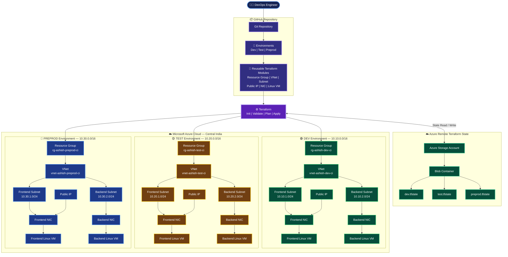

## 🏗️ Architecture Diagram

This project provisions Azure infrastructure using reusable Terraform modules across three isolated environments: Dev, Test, and Preprod.

### 📌 Infrastructure Overview

| Component | Dev | Test | Preprod |
|---|---:|---:|---:|
| Resource Groups | 1 | 1 | 1 |
| Virtual Networks | 1 | 1 | 1 |
| Subnets | 2 | 2 | 2 |
| Public IPs | 1 | 1 | 1 |
| Network Interfaces | 2 | 2 | 2 |
| Linux Virtual Machines | 2 | 2 | 2 |

### 🚀 Key Features

- **Reusable Terraform Modules:** Common infrastructure code for all environments.
- **Environment Isolation:** Separate Dev, Test and Preprod networks and resource groups.
- **Remote State Management:** Azure Blob Storage with separate state files.
- **Infrastructure as Code:** Repeatable Azure resource provisioning.
- **Network Segmentation:** Separate Frontend and Backend subnets.
- **Public and Private VM Access:** Public IP attached only to the Frontend VM; Backend VM has no public IP.

### 🔄 Terraform Deployment Workflow

1. Engineer updates Terraform code.
2. Code is stored in GitHub.
3. Select the target environment.
4. Terraform initializes the backend.
5. Terraform validates the configuration.
6. Terraform generates an execution plan.
7. Terraform applies the changes to Azure.
8. Terraform stores environment-specific state in Azure Blob Storage.
